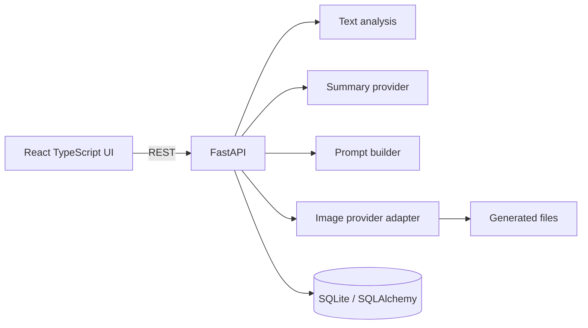
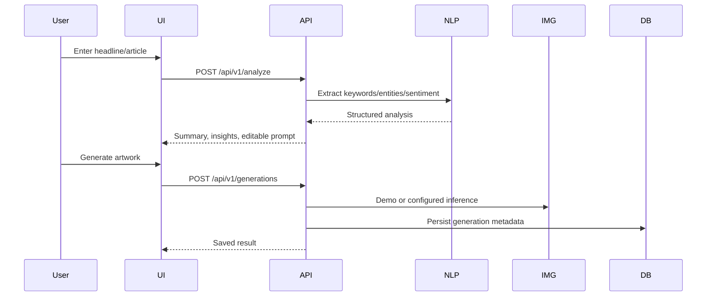
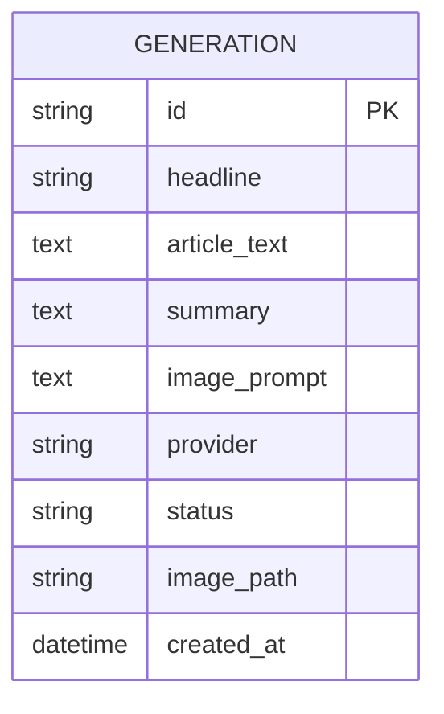

# NewsCanvas AI — AI Art Generator Based on News Headlines and Summarizer

A runnable final-year B.Tech CSE project: analyze a news headline/article, summarize text, extract lightweight NLP signals, build an editable image prompt, generate clearly labeled demo artwork or call a configured hosted inference endpoint, and persist history.

## Honest modes
- **Demo (default):** source-sentence selection for summaries and labeled SVG artwork. This is not real transformer or image-model inference.
- **Optional real summarization:** install `backend/requirements-ai.txt`, set `SUMMARIZATION_MODE=transformers`.
- **Optional real image generation:** set `IMAGE_PROVIDER=huggingface`, `HF_INFERENCE_URL`, and optionally `HF_API_TOKEN` in `backend/.env`.

## Start locally
Backend (Python 3.10+, recommended 3.11):
```bash
cd backend
python -m venv .venv
# Windows: .venv\Scripts\activate
# macOS/Linux: source .venv/bin/activate
pip install -r requirements.txt
# copy .env.example to .env
uvicorn app.main:app --reload --port 8000
```
Frontend (Node 18+), in another terminal:
```bash
cd frontend
npm install
npm run dev
```
Open `http://localhost:5173`. API docs: `http://localhost:8000/docs`.

Tests:
```bash
cd backend
pytest -q
```
Production frontend build:
```bash
cd frontend
npm run build
```

## Main functionality
- React + TypeScript + Vite UI with Studio, History, and About pages.
- FastAPI REST API, SQLite persistence, input validation, and image file storage.
- Keyword extraction, capitalization-based entity candidates, and lexicon sentiment heuristics.
- Short/medium/detailed summaries in demo mode; optional Transformers model mode.
- Editable visual prompt and style selector.
- Demo SVG image provider or configurable Hugging Face-compatible image endpoint.
- Searchable generation history, delete, image download, Markdown/JSON export.
- Basic URL-fetch endpoint with HTTP(S)-only checks, public DNS checks, no redirects, timeout and size limit.
- Mermaid architecture, sequence, and ER diagrams in this README.

## Architecture




## API
- `GET /health`
- `GET /api/v1/health/ready`
- `POST /api/v1/analyze`
- `POST /api/v1/summaries`
- `POST /api/v1/articles/fetch`
- `POST /api/v1/generations`
- `GET /api/v1/generations`
- `GET /api/v1/generations/{id}`
- `DELETE /api/v1/generations/{id}`
- `GET /api/v1/images/{filename}`
- `GET /api/v1/exports/{id}?format=markdown|json`

## Environment
Copy `backend/.env.example` to `backend/.env`.
- `DATABASE_URL`: defaults to local SQLite.
- `CORS_ORIGINS`: comma-separated allowed origins.
- `SUMMARIZATION_MODE`: `demo` or `transformers`.
- `SUMMARIZATION_MODEL`: optional Hugging Face summarization model.
- `IMAGE_PROVIDER`: `demo` or `huggingface`.
- `HF_INFERENCE_URL`, `HF_API_TOKEN`: server-side inference endpoint and token.
- `MAX_ARTICLE_CHARS`: article text size cap.

## Security, limitations, academic demo
This is a single-user/local-development project without authentication. Do not expose it publicly before adding authentication, authorization, rate limits, production storage, and network-level SSRF controls. URL retrieval is intentionally restrictive but still needs production hardening. NLP analysis uses transparent heuristics, not trained NER or sentiment models. Generated images may be inaccurate and are illustrations, not documentary evidence. No news API is enabled by default. Do not report evaluation scores until measured; see `docs/evaluation.md`.
